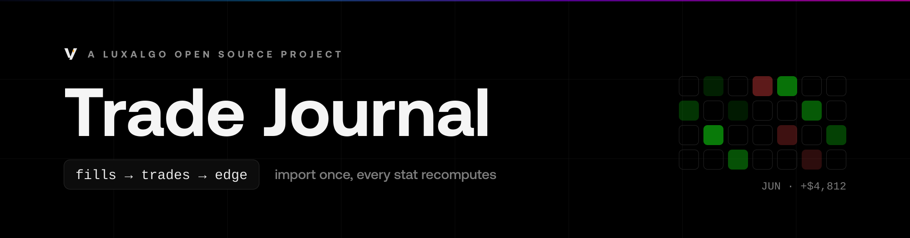

<div align="center">



<br/>

### 📊 The Modern Open-Source Trade Journal & Analytics Platform
**Sinkronisasi Realtime MetaTrader 4 & 5, Analisis Mendalam, Kalender P&L, Replay Transaksi, dan AI Reflection.**  
*Self-hosted, aman, database SQLite lokal, dan 100% gratis selamanya.*

[](https://github.com/princevalerie/Trade_Journal)
[](https://nodejs.org)
[](https://pnpm.io)
[](LICENSE)
[](#arsitektur-data)

---

[Instalasi Server / VPS](#-1-panduan-instalasi-di-server--vps) · [Penggunaan CLI Manager](#-2-panduan-lengkap-trade-journal-cli-manager) · [Update 1-Klik](#-3-cara-update-otomatis-dari-github-1-perintah) · [Sinkronisasi MT4 & MT5](#-5-sinkronisasi-metatrader-4--metatrader-5-webhook) · [Fitur Utama](#-6-fitur-unggulan-trade-journal) · [Troubleshooting](#-8-troubleshooting--faq)

</div>

---


---

## ⚡ Kebutuhan Sistem (Prerequisites)

Sebelum menginstal, pastikan server atau komputer Anda sudah terpasang:
- **Node.js**: Versi **22.x LTS** ke atas ([Unduh Node.js](https://nodejs.org))
- **pnpm**: Versi **11.x** (`npm install -g pnpm`)
- **Git**: Terpasang di sistem (`git --version`)
- **Sistem Operasi**: Linux (Ubuntu 20.04/22.04/24.04, Debian), Windows 10/11 / Windows Server, atau macOS.

---

## 🚀 1. Panduan Instalasi di Server / VPS

### Langkah 1: Persiapan Environment di VPS (Ubuntu/Debian)
Buka terminal SSH VPS Anda dan jalankan perintah berikut:

```bash
# Update sistem
sudo apt update && sudo apt upgrade -y

# Install Git & Curl
sudo apt install -y git curl

# Install Node.js 22 LTS
curl -fsSL https://deb.nodesource.com/setup_22.x | sudo -E bash -
sudo apt install -y nodejs

# Install pnpm & PM2 (Process Manager) secara global
sudo npm install -g pnpm pm2
```

### Langkah 2: Clone Repository dari GitHub
```bash
# Clone project ke server
git clone https://github.com/princevalerie/Trade_Journal.git

# Masuk ke folder project
cd Trade_Journal

# Berikan izin eksekusi pada script launcher CLI (khusus Linux/macOS)
chmod +x journal.sh
```

### Langkah 3: Install Dependencies & Build Aplikasi
```bash
# Install seluruh library yang dibutuhkan
pnpm install

# Build / compile aplikasi Next.js untuk production
pnpm build
```

### Langkah 4: Jalankan Server
```bash
# Menggunakan CLI Manager bawaan (Rekomendasi)
./journal.sh start
# atau
node journal.js start
```
Aplikasi kini aktif dan berjalan di port **3000** (`http://IP_VPS_ANDA:3000`).

---

## 💻 2. Panduan Lengkap Trade Journal CLI Manager

Aplikasi ini sudah dilengkapi dengan **CLI Manager Mandiri** (`journal.js` / `journal.sh` / `journal.bat`) tanpa perlu menginstall tools tambahan. CLI ini dirancang untuk memudahkan segala kebutuhan administrasi server.

### 🎮 Cara Membuka Menu Interaktif
- **Di Linux VPS / macOS:**
  ```bash
  ./journal.sh
  ```
- **Di Windows Server / Lokal:**
  ```cmd
  journal
  REM atau: node journal.js
  ```
- **Melalui pnpm:**
  ```bash
  pnpm journal
  ```

### 🖥️ Tampilan Menu Interaktif:
```text
╔═══════════════════════════════════════════════════════════╗
║            📊 TRADE JOURNAL MANAGER (CLI)                 ║
╚═══════════════════════════════════════════════════════════╝
 Status Server: ● RUNNING (PM2, Port: 3000, PID: 14205)

[1] 🚀 Start Server (Production)
[2] 🛠️  Start Server (Dev / Turbopack)
[3] ⏹️  Stop Server
[4] 🔄 Restart Server
[5] ⬇️  Update / Upgrade dari GitHub (Git Pull + Rebuild)
[6] 🔨 Build Aplikasi Manual (pnpm build)
[7] 💾 Backup Database
[8] ♻️  Restore Database
[9] 📜 Lihat Log Server
[0] ❌ Keluar

Pilih nomor menu [0-9]:
```

---

## 🔄 3. Cara Update Otomatis dari GitHub (1 Perintah)

Ketika Anda melakukan update kode di laptop lalu push ke GitHub, Anda **TIDAK PERLU** lagi login ke VPS dan mengetik rentetan perintah panjang. Cukup jalankan:

```bash
node journal.js update
```
*(atau buka `./journal.sh` lalu pilih menu **[5]**)*

### ⚙️ Alur Kerja Otomatis Fitur Update:
1. 💾 **Auto-Backup Database:** Database SQLite Anda saat ini otomatis disalin ke folder `backups/` sebagai cadangan keamanan.
2. ⬇️ **Git Pull:** Menarik seluruh perubahan kode terbaru dari repositori GitHub.
3. 📦 **Pnpm Install:** Otomatis mengupdate dan menginstall package baru jika ada dependensi yang diperbarui.
4. 🔨 **Pnpm Build:** Mengompilasi ulang aplikasi Next.js ke versi paling optimal.
5. 🔄 **Auto-Restart:** Server yang sedang berjalan otomatis direstart secara mulus (zero-downtime) dengan versi terbaru tanpa mematikan data transaksi Anda!

---

## 📋 4. Daftar Perintah CLI (Cheat-Sheet)

Selain menggunakan menu interaktif, Anda juga bisa menjalankan perintah langsung via CLI:

| Perintah | Fungsi | Contoh Penggunaan |
| :--- | :--- | :--- |
| `node journal.js` | Membuka **Menu Interaktif** TUI | `./journal.sh` |
| `node journal.js start` | Menjalankan server di background (Production/PM2) | `node journal.js start` |
| `node journal.js stop` | Menghentikan server yang berjalan | `node journal.js stop` |
| `node journal.js restart` | Me-restart server Trade Journal | `node journal.js restart` |
| `node journal.js update` | **Update otomatis dari GitHub** + Rebuild + Auto-Restart | `node journal.js update` |
| `node journal.js status` | Cek status server (aktif/mati, PID, port) | `node journal.js status` |
| `node journal.js logs` | Memantau log server secara realtime (Live Tail) | `node journal.js logs` |
| `node journal.js backup` | Mem-backup database SQLite ke folder `backups/` | `node journal.js backup` |
| `node journal.js restore` | Me-restore database dari daftar cadangan backup | `node journal.js restore` |
| `node journal.js build` | Menjalankan build manual Next.js (`pnpm build`) | `node journal.js build` |
| `node journal.js dev` | Menjalankan server dalam mode pengembangan (hot-reload) | `node journal.js dev` |
| `node journal.js help` | Menampilkan ringkasan bantuan perintah | `node journal.js help` |

---

## 🤖 5. Sinkronisasi MetaTrader 4 & MetaTrader 5 (Webhook)

Trade Journal dilengkapi dengan skrip sinkronisasi institusional berkinerja tinggi untuk MT4 dan MT5 di folder `scripts/`:

### A. Pengaturan di MetaTrader 5 (MT5):
1. Salin file `scripts/mt5/TradeJournalSync.mq5` ke folder `MQL5/Experts/` terminal MT5 Anda.
2. Compile skrip di MetaEditor (tekan `F7`).
3. Di MT5, buka menu **Tools** -> **Options** -> **Expert Advisors**:
   - Centang **"Allow algorithmic trading"**.
   - Centang **"Allow WebRequest for listed URL"**, lalu tambahkan URL server Anda:
     - Jika di VPS yang sama: `http://127.0.0.1:3000`
     - Jika VPS berbeda/remote: `https://domain-anda.com` atau `http://IP_VPS:3000`
4. Pasang Expert Advisor `TradeJournalSync` ke salah satu chart.
5. Masukkan parameter input:
   - `InpApiUrl`: `http://127.0.0.1:3000/api/webhooks/mt5` (atau URL domain publik Anda).
   - `InpApiKey`: Masukkan secret key jika Anda mengaktifkan `MT_WEBHOOK_SECRET`.

### B. Pengaturan di MetaTrader 4 (MT4):
1. Salin file `scripts/mt4/TradeJournalSync.mq4` ke folder `MQL4/Experts/` terminal MT4 Anda, lalu compile.
2. Di MT4, buka menu **Tools** -> **Options** -> **Expert Advisors**:
   - Centang **"Allow WebRequest for listed URL"**, lalu masukkan URL server Anda.
3. *Catatan Port MT4:* MT4 WebRequest memiliki batasan bawaan yang menyukai Port 80. Jika Anda menjalankan MT4 di VPS lokal bersama web app, Anda dapat menyalakan proxy bawaan:
   ```bash
   node scripts/mt4-proxy.js
   ```
   Lalu arahkan URL MT4 ke `http://127.0.0.1/api/webhooks/mt4`.

### C. Fitur Pengelompokan EA Cerdas (Magic Number):
Aplikasi ini secara otomatis mengenali dan menyatukan seluruh transaksi dari satu robot EA meskipun komentar orderya berbeda-beda (misal `Scalp_Buy` & `Scalp_Sell`):
- Pilihan filter di UI akan menampilkan format: **`MagicNumber#namakomentar1#namakomentar2`** (contoh: `20260919#HullMA Long v2#PPT_HullATR`).
- Filter murni berfokus pada **Magic Number**, sehingga 100% transaksi dari EA tersebut tercatat sebagai satu kesatuan performa yang akurat.

---

## 🛡️ 6. Menjalankan 24/7 di Server VPS (Auto-Start saat Reboot)

Untuk memastikan server selalu menyala dan otomatis aktif kembali jika server VPS mengalami restart atau mati mendadak, gunakan integrasi **PM2**:

```bash
# 1. Jalankan aplikasi via PM2
node journal.js start

# 2. Simpan daftar proses aktif PM2
pm2 save

# 3. Aktifkan auto-startup pada sistem operasi
pm2 startup
```
*(Ikuti perintah baris tunggal yang ditampilkan terminal untuk mengunci konfigurasi startup).*

---

## ⚙️ 7. Konfigurasi Lingkungan (`.env`)

Konfigurasi opsional dapat dibuat pada file `.env` di root atau `apps/web/.env.local`:

```env
# Port server (default: 3000)
PORT=3000

# Password akses dashboard (opsional, sangat disarankan jika VPS dapat diakses publik)
JOURNAL_PASSWORD=PasswordKuatAndaDisini

# Kunci integrasi AI untuk refleksi trading (opsional)
ANTHROPIC_API_KEY=sk-ant-...
OPENAI_API_KEY=sk-proj-...
```

---

## ✨ 8. Fitur Unggulan Trade Journal

- **Sinkronisasi Multi-Akun Otomatis:** Menghubungkan banyak akun MT4 & MT5 sekaligus ke dalam satu dashboard terpusat.
- **P&L Calendar & Equity Curve:** Visualisasi kalender harian profit/loss, win rate, profit factor, dan kurva pertumbuhan modal.
- **Pencatatan Lengkap:** Otomatis merekam Stop Loss, Take Profit, Slippage, Komisi Broker, Biaya Swap, dan MAE/MFE (Max Adverse/Favorable Excursion).
- **Pencarian & Multi-Filter EA:** Filter transaksi berdasarkan Akun, Simbol, Tanggal, Gaya Trading, hingga drilldown ke masing-masing Magic Number EA.
- **Catatan & Refleksi Harian:** Mendukung Markdown, checklist kesalahan trading (mistakes tracking), evaluasi playbook, dan integrasi AI Journaling.
- **Manajemen Akun Prop Firm:** Fitur pemantauan evaluasi prop firm, target profit, batas drawdown harian, dan riwayat payout.
- **Privasi 100% Milik Anda:** Data tersimpan lokal di SQLite server Anda sendiri. Tidak ada data finansial yang dibagikan ke server pihak ketiga.

---

## ❓ 9. Troubleshooting & FAQ

#### Q: Bagaimana cara melihat log server jika terjadi kendala?
Cukup jalankan perintah:
```bash
node journal.js logs
```
Atau jika menggunakan PM2:
```bash
pm2 logs trade-journal
```

#### Q: Webhook MT5 / MT4 memunculkan pesan error "WebRequest failed (404)"?
1. Pastikan URL di input EA sudah menyertakan path lengkap: `/api/webhooks/mt5` atau `/api/webhooks/mt4`.
2. Pastikan domain/IP server sudah dimasukkan ke daftar **Allow WebRequest** di menu `Tools -> Options -> Expert Advisors` terminal MetaTrader.
3. Pastikan firewall VPS Anda mengizinkan port yang digunakan (misal port 3000 atau port 80/443).

#### Q: Bagaimana cara mereset atau membersihkan cache build?
Jalankan perintah rebuild manual:
```bash
node journal.js build
```

---

<div align="center">

**Trade Journal Community Edition**  
*Dikelola dan dikembangkan untuk komunitas trader Indonesia & Global.*

</div>
